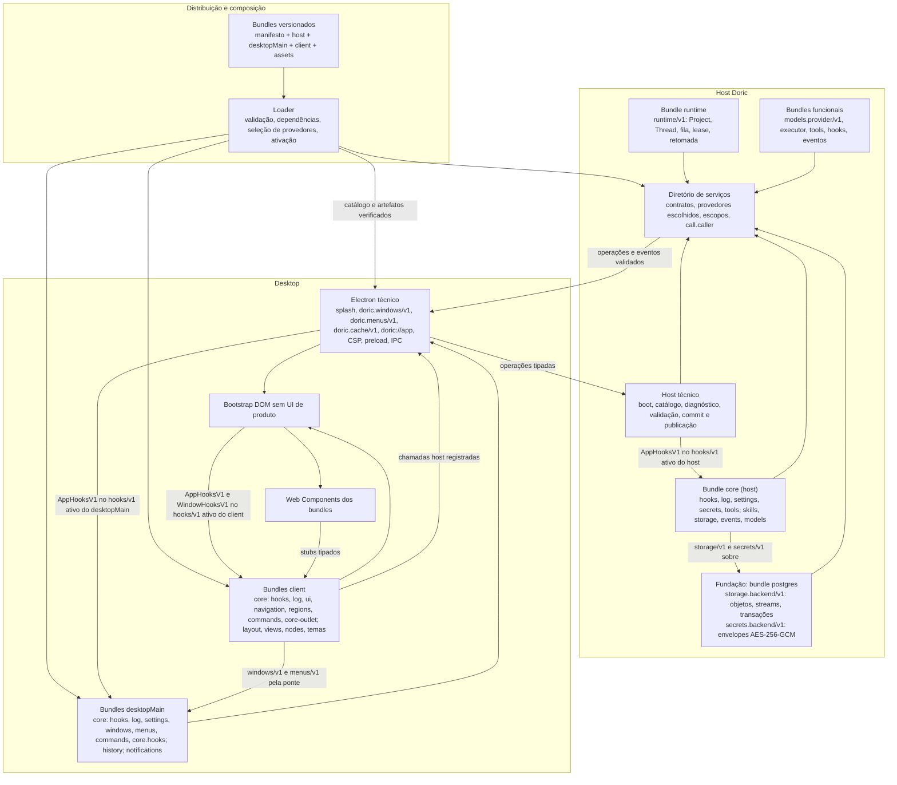

# Arquitetura de bundles do Doric — proposta

**Estado:** desenho de destino e plano de migração; nada aqui descreve comportamento já implementado. `GROUNDING.md` continua sendo o contrato da implementação atual até que cada etapa seja aprovada, entregue e refletida nele.

## Objetivo e alcance

Bundles devem poder definir toda a experiência de produto: providers, executores, tools, skills, modelos de domínio como Project e Thread, funcionalidades do host, eventos, hooks, nodes de execução e **100% dos componentes da interface**, inclusive layout, navegação, conversa, settings, temas e janelas. O ciclo de vida do app é definido por hooks: a plataforma define os hooks padrão do ciclo de vida no provedor ativo de `hooks/v1` de cada ambiente, o core abre as janelas e decide o que os outros bundles podem fazer nelas, e qualquer bundle pode definir hooks próprios para que outros modifiquem seu comportamento. O Doric distribui uma composição padrão feita desses bundles. Outra composição pode substituir até a interface principal.

“100% da UI” significa que nenhum componente montado, tela, rota visual, posição de painel, tipo de janela ou tipo de node de conversa é obrigatório no bootstrap do renderer. O core decide, por código nos hooks do app, quais janelas abrir no início ou na reativação; `workspace` e `settings` são janelas do core padrão. Electron ainda cria as instâncias nativas, mostra a superfície técnica de splash e recuperação, mantém o isolamento e a CSP que já aplica hoje, serve assets por `doric://app` e fornece a ponte tipada. O app também fornece **pacotes compartilhados** (React, Lexical, todos os componentes shadcn, Tailwind e o tema principal) que os bundles consomem; eles são bibliotecas disponíveis, não UI montada. Se nenhum bundle ativo registrar a rota do path de uma janela, o `<core-outlet>` do core mostra `<core-not-found>` no lugar.

O projeto não precisa converter cada pacote em bundle. Bibliotecas como `agent`, `llms`, `sandbox`, `tool` e `state-machine` continuam fornecendo contratos e implementações reutilizáveis; bundles selecionam funcionalidades concretas e as instalam na aplicação. O host técnico precisa conhecer o protocolo de carregamento, armazenamento e publicação, mas não os campos ou regras de Project e Thread. Um bundle estrutural da composição padrão, `runtime`, define esses dois modelos e seu ciclo de execução.

O contexto de ativação entrega só serviços: `activate(ctx)` recebe `{ services }` em todos os ambientes, e tudo o mais (hooks, log, settings, secrets, tools, storage, eventos, comandos, UI, janelas e menus) é um contrato de serviço. Em cada ambiente, o loader ativa primeiro a **fundação**: os bundles escolhidos em `providers` para contratos que o core fornece ou consome, como `postgres` para `storage.backend/v1` e `secrets.backend/v1` ou um `myhooks` para `hooks/v1`. Bundles da fundação só declaram `requires` de contratos `doric.*`. Depois vem o **bundle core**, que pode exigir apenas contratos fornecidos pela fundação (`storage.backend/v1`, `secrets.backend/v1`) e fornece, por padrão, os serviços básicos, o esqueleto das janelas e do menu e as regiões sobre as quais os demais bundles adicionam funcionalidade. Por último vêm os demais bundles, em ordem de dependência. Como são contratos, outro bundle pode substituir qualquer um deles pela composição, e a própria plataforma os consome pelo contrato, sem conhecer a implementação.

## Decisões de 2026-10-08

As linhas revisadas em 2026-10-09 trazem esse estado na coluna Estado; a revisão prevalece sobre qualquer texto anterior da proposta.

| Tema                                      | Decisão                                                                                                                                                                                                                                                                                                                                                                                                                                                                                                                                                                                                                                                                                                                                                                                                                                                                                                                                                                                                                                                                                                                                                                                                                                                                                                                                                                                                                              | Estado                          | Documento                                                                                                                                                         |
| ----------------------------------------- | ------------------------------------------------------------------------------------------------------------------------------------------------------------------------------------------------------------------------------------------------------------------------------------------------------------------------------------------------------------------------------------------------------------------------------------------------------------------------------------------------------------------------------------------------------------------------------------------------------------------------------------------------------------------------------------------------------------------------------------------------------------------------------------------------------------------------------------------------------------------------------------------------------------------------------------------------------------------------------------------------------------------------------------------------------------------------------------------------------------------------------------------------------------------------------------------------------------------------------------------------------------------------------------------------------------------------------------------------------------------------------------------------------------------------------------ | ------------------------------- | ----------------------------------------------------------------------------------------------------------------------------------------------------------------- |
| Fonte de verdade                          | O host guarda bundles instalados, artefatos e composição; o desktop baixa, verifica e ativa durante o splash.                                                                                                                                                                                                                                                                                                                                                                                                                                                                                                                                                                                                                                                                                                                                                                                                                                                                                                                                                                                                                                                                                                                                                                                                                                                                                                                        | Aceita                          | [Composição e distribuição](./bundles/composition-and-distribution.md)                                                                                            |
| Contexto só com serviços                  | `activate(ctx)` recebe só `services`: partes `host` usam `HostContext`, partes `desktopMain` usam `DesktopContext` e partes `client` usam `ClientContext`, os três com `{ readonly services: Services }`; o core recebe o mesmo contexto que qualquer bundle. Hooks, log, settings, secrets, tools, skills, storage, eventos, comandos, UI, janelas e menus viram contratos de serviço; `activate` pode devolver uma função de limpeza. Cada handler recebe `call`; todo stub aceita como último argumento opcional o `call` pai ou `{ signal, deadline }`, o dispatcher herda do pai `scope`, `signal` e `trace`, preenche `scope.windowKey` nas chamadas que saem de uma janela client e preenche `call.caller` (`{ bundleId, version, generation }`) com o bundle que faz a chamada, sem herdá-lo.                                                                                                                                                                                                                                                                                                                                                                                                                                                                                                                                                                                                                                | Aceita (revisada em 2026-10-09) | [Contextos e capacidades](./bundles/contexts.md)                                                                                                                  |
| Fundação e bundle core                    | Cada composição nomeia exatamente um bundle core. Em cada ambiente, o loader ativa primeiro a fundação (os provedores escolhidos em `providers` para contratos que o core fornece ou consome, que só exigem contratos `doric.*`), depois o core e por último os demais bundles, em ordem de dependência. O core só pode exigir contratos da fundação (`storage.backend/v1`, `secrets.backend/v1`). Ele cobre todas as funcionalidades básicas: no `host`, `hooks/v1`, `log/v1`, `settings/v1`, `secrets/v1`, `tools/v1`, `skills/v1`, `storage/v1`, `events/v1` e `models/v1` (que agrega os provedores de `models.provider/v1`); no `desktopMain`, `hooks/v1`, `log/v1`, `settings/v1` (preferências locais do desktop), `windows/v1`, `menus/v1`, `commands/v1` e `core.hooks/v1`, com a janela principal, o esqueleto do menu montado no `onAppReadyHook`, os atalhos básicos e a abertura de settings; no `client`, `hooks/v1`, `log/v1`, `ui/v1`, `navigation/v1`, `regions/v1` e `commands/v1`, com os elementos `<core-outlet>`, `<core-region>`, `<core-not-found>` e `<core-unavailable>` (veja [UI no client](./bundles/core.md#ui-no-client)); a janela abre num path e o `<core-outlet>` mostra a rota casada, o workspace é do [layout](./bundles/layout.md) e a página de settings é do bundle `settings`. `commands/v1` não existe no `host`. Ele abre as janelas e decide o que os outros bundles podem fazer nelas. | Aceita (revisada em 2026-10-09) | [Bundle core e quarentena](./bundles/core.md)                                                                                                                     |
| Substituição de contratos e cardinalidade | Qualquer contrato sem prefixo `doric.` pode ser fornecido por outro bundle. Cada contrato declara cardinalidade nas opções de `defineService`: `one` (padrão; um provedor ativo, escolhido pela composição) ou `many` (vários provedores sem conflito, agregados pelo consumidor, como `models.provider/v1`). A escolha em `providers` vale em cada ambiente em que o bundle escolhido fornece o contrato; nos outros, o provedor padrão continua. Quando a composição escolhe outro provedor para um contrato que o core também fornece, o loader não registra a implementação do core naquele ambiente, e o `services.use` do próprio core devolve o provedor escolhido. Sem escolha, o segundo provedor de um contrato `one` vai para quarentena com motivo; como a fundação e o core ativam antes, é o substituto não escolhido que vai para quarentena. Os antigos papéis exclusivos são contratos `one` (`storage.backend/v1`, `secrets.backend/v1`, `runtime/v1`, `executor/v1`, `sandbox/v1`); contratos `doric.*` são da plataforma e não aceitam outro provedor.                                                                                                                                                                                                                                                                                                                                                           | Aceita (revisada em 2026-10-09) | [Composição e distribuição](./bundles/composition-and-distribution.md), [contextos e capacidades](./bundles/contexts.md)                                          |
| Nomes mínimos                             | IDs de bundle sem prefixo `doric.` nem sufixo `-default` (`core`, `postgres`, `runtime`, `layout`, `settings`, `chat`, `history`, `files`, `openai`, `openrouter`, `codex`, `docker`, `firecracker`, `notifications`, `transport`, `pool`, `git`; exemplos `allowlist`, `rules`, `geometry`, `graph`); contratos básicos só com o domínio (`hooks/v1`, `windows/v1`); contratos da plataforma com `doric.*`; contratos de outros bundles como `<bundle>.<nome>/vN`; tags de custom elements começam com o ID do bundle dono. O evento usado por `notifications` é `runtime.prompt-finished/v1`.                                                                                                                                                                                                                                                                                                                                                                                                                                                                                                                                                                                                                                                                                                                                                                                                                                      | Aceita (revisada em 2026-10-09) | [Divisão das funcionalidades atuais](./bundles/feature-split.md), [contratos e a família define\*](./bundles/contracts.md), [manifesto v1](./bundles/manifest.md) |
| Falhas de ativação                        | Bundle não core com falha no `activate` entra em quarentena; falha do core abre o modo de recuperação. Falha de um handler de `onActivateHook` (`observe`) vai só ao diagnóstico, sem quarentena.                                                                                                                                                                                                                                                                                                                                                                                                                                                                                                                                                                                                                                                                                                                                                                                                                                                                                                                                                                                                                                                                                                                                                                                                                                    | Aceita (revisada em 2026-10-09) | [Bundle core e quarentena](./bundles/core.md), [splash e recuperação](./bundles/splash-and-recovery.md)                                                           |
| Gerações `desktopMain`                    | Só a parte `client` fica fixada por janela; trocar código `desktopMain` reinicia o processo dele; IPC de bundles passa por um dispatcher único.                                                                                                                                                                                                                                                                                                                                                                                                                                                                                                                                                                                                                                                                                                                                                                                                                                                                                                                                                                                                                                                                                                                                                                                                                                                                                      | Aceita                          | [Isolamento por processo](./bundles/process-isolation.md)                                                                                                         |
| Origem local                              | Shell, pacotes da plataforma e assets de bundles são servidos pela origem única `doric://app`; a CSP é gerada pelo main.                                                                                                                                                                                                                                                                                                                                                                                                                                                                                                                                                                                                                                                                                                                                                                                                                                                                                                                                                                                                                                                                                                                                                                                                                                                                                                             | Aceita                          | [Protocolo doric://](./bundles/doric-protocol.md)                                                                                                                 |
| Splash e recuperação                      | Uma única superfície técnica do app, fora dos bundles; acompanha o carregamento e vira a tela de recuperação quando algo falha, inclusive o core.                                                                                                                                                                                                                                                                                                                                                                                                                                                                                                                                                                                                                                                                                                                                                                                                                                                                                                                                                                                                                                                                                                                                                                                                                                                                                    | Aceita                          | [Splash e recuperação](./bundles/splash-and-recovery.md)                                                                                                          |
| Aparência nativa                          | A chamada de abertura declara a intenção; tokens da plataforma definem as medidas; o main aplica e informa a área segura à janela.                                                                                                                                                                                                                                                                                                                                                                                                                                                                                                                                                                                                                                                                                                                                                                                                                                                                                                                                                                                                                                                                                                                                                                                                                                                                                                   | Aceita                          | [Aparência nativa da janela](./bundles/window-appearance.md)                                                                                                      |
| Hooks e ciclo de vida                     | Depois que o provedor de `hooks/v1` de um ambiente ativa (o core, por padrão, ou o escolhido em `providers`), a plataforma daquele ambiente chama `define(AppHooksV1)` e passa a disparar `execute`. `WindowHooksV1` (`onCloseHook`, `onFlushHook`) é definido pela plataforma no `client`: o bootstrap de cada janela o define no `hooks/v1` do client e o executa quando o main pede o fechamento. Qualquer bundle, não só o core, registra handlers dos hooks do app; quem é dono de uma operação define os hooks dela, e qualquer bundle pode definir hooks próprios. Nomes `on<Ponto>Hook`.                                                                                                                                                                                                                                                                                                                                                                                                                                                                                                                                                                                                                                                                                                                                                                                                                                     | Aceita (revisada em 2026-10-09) | [Hooks e ciclo de vida](./bundles/hooks.md)                                                                                                                       |
| Cache local de histórico                  | Chave por host, geração do storage e Thread; invalidação por truncamento ou schema incompatível. O diretório de cache por bundle vem de `doric.cache/v1`, contrato da plataforma no `desktopMain`, e `history` grava nele `<hostId>/<storageGeneration>/<threadId>`.                                                                                                                                                                                                                                                                                                                                                                                                                                                                                                                                                                                                                                                                                                                                                                                                                                                                                                                                                                                                                                                                                                                                                                 | Aceita (revisada em 2026-10-09) | [Armazenamento genérico e histórico](./bundles/storage.md)                                                                                                        |
| Schemas                                   | JSON Schema 2020-12 é o formato canônico serializável; o código pode gerá-lo a partir de zod.                                                                                                                                                                                                                                                                                                                                                                                                                                                                                                                                                                                                                                                                                                                                                                                                                                                                                                                                                                                                                                                                                                                                                                                                                                                                                                                                        | Aceita                          | [Contratos e a família define\*](./bundles/contracts.md)                                                                                                          |
| Contratos `define*` e imports             | Contratos são escritos em zod com as funções `define*` de `bundle/contracts`, no molde do `defineTool`; o JSON Schema canônico passa a ser sempre gerado deles no build, e nenhum bundle escreve JSON Schema à mão. `bundle/contracts` exporta também `ref`, os tipos de contexto e `Call`, as constantes dos contratos da plataforma e as referências e os tipos dos contratos básicos, cujas definições com `execute` o core fornece; `core/contracts` exporta só `CoreHooksV1` e a referência `OpenSettingsCommandV1` ao comando `core.open-settings/v1`; contratos de outros bundles vêm de `<bundle>/contracts`, e o próprio bundle importa os seus por caminho relativo.                                                                                                                                                                                                                                                                                                                                                                                                                                                                                                                                                                                                                                                                                                                                                       | Aceita (revisada em 2026-10-09) | [Contratos e a família define\*](./bundles/contracts.md)                                                                                                          |
| Janelas, menus e atalhos                  | Abertos e registrados por código do core, sem manifesto, sobre `doric.windows/v1` e `doric.menus/v1`, usados pelo core; outros bundles usam `windows/v1` (abrir e focar janelas pelas políticas do core) e `menus/v1` (itens, atalhos e `setContext`), que o core fornece no `desktopMain` e as partes `client` alcançam pela ponte. Comandos de UI e de menu são definidos e registrados em `commands/v1` na parte `client` ou `desktopMain`.                                                                                                                                                                                                                                                                                                                                                                                                                                                                                                                                                                                                                                                                                                                                                                                                                                                                                                                                                                                       | Aceita (revisada em 2026-10-09) | [Janelas abertas pelo core](./bundles/windows.md), [menus nativos e atalhos](./bundles/menus-and-keybindings.md)                                                  |
| Pacotes compartilhados                    | O app fornece por import map React, Lexical, o registro shadcn completo, Tailwind e os tokens do tema principal.                                                                                                                                                                                                                                                                                                                                                                                                                                                                                                                                                                                                                                                                                                                                                                                                                                                                                                                                                                                                                                                                                                                                                                                                                                                                                                                     | Aceita                          | [Pacotes compartilhados e tokens do tema](./bundles/platform-packages.md)                                                                                         |
| Storage e segredos                        | Genérico e independente de backend; o core fornece `storage/v1` como fachada sobre `storage.backend/v1`; PostgreSQL (bundle `postgres`) é o primeiro backend, e um banco de documentos deve caber no mesmo contrato. `postgres` também fornece por padrão `secrets.backend/v1`, que guarda cada segredo como envelope AES-256-GCM sob `DORIC_CREDENTIAL_KEY`, como o credential store atual do host; `secrets/v1` do core é a fachada sobre ele e mantém a redação atual nos logs.                                                                                                                                                                                                                                                                                                                                                                                                                                                                                                                                                                                                                                                                                                                                                                                                                                                                                                                                                   | Aceita (revisada em 2026-10-09) | [Armazenamento genérico e histórico](./bundles/storage.md)                                                                                                        |
| Versionamento                             | Semantic versioning para plataforma, bundles e contratos.                                                                                                                                                                                                                                                                                                                                                                                                                                                                                                                                                                                                                                                                                                                                                                                                                                                                                                                                                                                                                                                                                                                                                                                                                                                                                                                                                                            | Aceita, política proposta       | [Versionamento semântico](./bundles/versioning.md)                                                                                                                |
| Manifesto                                 | Manifesto v1 mínimo: `manifestVersion`, `id`, `version`, `engines`, `provides`, `requires` e `description` opcional; o resto vem de convenção ou de registro em código.                                                                                                                                                                                                                                                                                                                                                                                                                                                                                                                                                                                                                                                                                                                                                                                                                                                                                                                                                                                                                                                                                                                                                                                                                                                              | Proposta para revisão           | [Manifesto v1](./bundles/manifest.md)                                                                                                                             |
| Observabilidade                           | Logs estruturados, rastreio de chamadas, métricas e diagnóstico entram no plano desde a primeira etapa. `bundleId`, `version` e `generation` vêm de `call.caller`; `environment` vem do processo do provedor de `log/v1`. A plataforma tem log próprio, independente do core.                                                                                                                                                                                                                                                                                                                                                                                                                                                                                                                                                                                                                                                                                                                                                                                                                                                                                                                                                                                                                                                                                                                                                        | Aceita (revisada em 2026-10-09) | [Observabilidade e diagnóstico](./bundles/observability.md)                                                                                                       |
| Isolamento por processo                   | Opção B: um processo por geração de bundles no host e um `utilityProcess` por geração no desktop.                                                                                                                                                                                                                                                                                                                                                                                                                                                                                                                                                                                                                                                                                                                                                                                                                                                                                                                                                                                                                                                                                                                                                                                                                                                                                                                                    | Aceita                          | [Isolamento por processo](./bundles/process-isolation.md)                                                                                                         |
| Threads, rotas e elementos                | Envio de prompt, leitura de Threads e controles de Threads filhas do `Host` atual ficam em `runtime.threads/v1` (`RuntimeThreadsV1`); `threads.commands/v1` deixa de existir, e o bundle `threads` fica com as tools de delegação e os cards. Uma rota é um path de URL registrado em `navigation/v1`, que o core fornece no client; a rota de Thread é `/projects/:projectId/threads/:threadId`, registrada pelo `chat` com `parent: '/'`, e aparece no `<core-outlet>` do [layout](./bundles/layout.md). Quem quer a conversa usa `ui.create('chat-view', { projectId, threadId })` ou navega para o path. Itens de região têm IDs sem versão (`providers`, na região `settings.sections`), e a seção correspondente é a rota `/settings/providers`.                                                                                                                                                                                                                                                                                                                                                                                                                                                                                                                                                                                                                                                                               | Aceita (revisada em 2026-10-09) | [O bundle chat](./bundles/chat.md), [navegação e rotas](./bundles/navigation.md), [divisão das funcionalidades atuais](./bundles/feature-split.md)                |
| Pacotes da plataforma                     | `packages/desktop` é o runtime client do loader usado por `app/desktop/doric-renderer`, e bundles não o importam; `desktop/ui` continua com componentes, tokens e Tailwind.                                                                                                                                                                                                                                                                                                                                                                                                                                                                                                                                                                                                                                                                                                                                                                                                                                                                                                                                                                                                                                                                                                                                                                                                                                                          | Aceita (revisada em 2026-10-09) | [Pacotes compartilhados e tokens do tema](./bundles/platform-packages.md)                                                                                         |
| Primeiras etapas da migração              | A etapa 1 entrega o contexto só com serviços, `bundle/contracts` com `define*`, `ref` e as referências dos básicos, o core com `hooks/v1`, `log/v1`, `tools/v1` e `skills/v1` e `bundles/foundation/core` renomeado para `files`; a etapa 2 traz `settings/v1`, `secrets/v1`, `storage/v1` e `events/v1` do core, com `postgres` fornecendo `storage.backend/v1` e `secrets.backend/v1` sobre o Prisma atual. As onze etapas mantêm a numeração.                                                                                                                                                                                                                                                                                                                                                                                                                                                                                                                                                                                                                                                                                                                                                                                                                                                                                                                                                                                     | Aceita (revisada em 2026-10-09) | [Migração em entregas verificáveis](./bundles/migration.md)                                                                                                       |
| Prova de substituibilidade                | Um core mínimo de teste abre uma janela sem nenhum bundle da UI padrão.                                                                                                                                                                                                                                                                                                                                                                                                                                                                                                                                                                                                                                                                                                                                                                                                                                                                                                                                                                                                                                                                                                                                                                                                                                                                                                                                                              | Aceita                          | [Bundle core e quarentena](./bundles/core.md)                                                                                                                     |
| Confiança e instalação externa            | Assinatura, origem permitida e consentimento ficam para uma decisão futura.                                                                                                                                                                                                                                                                                                                                                                                                                                                                                                                                                                                                                                                                                                                                                                                                                                                                                                                                                                                                                                                                                                                                                                                                                                                                                                                                                          | Adiada                          | [Composição e distribuição](./bundles/composition-and-distribution.md)                                                                                            |

## Evidência na implementação atual

> Esta seção descreve o código de 2026-10-08, antes da migração, e fica como registro da evidência. O estado atual está em [decisões de implementação](./bundles/implementation-decisions.md) e em `GROUNDING.md`.

| Área                 | Ponto atual de acoplamento                                                                                                                                                                                                                                                                             |
| -------------------- | ------------------------------------------------------------------------------------------------------------------------------------------------------------------------------------------------------------------------------------------------------------------------------------------------------ |
| Recursos de bundles  | `packages/bundle/src/lib/load.ts` e `bundles/{core,git,threads}/manifest.json` carregam apenas tools e skills.                                                                                                                                                                                         |
| Composição           | `agents/doric/src/index.ts` carrega bundles e escolhe sandbox; `agents/doric/src/lib/config/generation.ts` achata tools/skills e cria providers.                                                                                                                                                       |
| Persistência         | `agents/doric/prisma/schema.prisma` fixa Project, Thread, eventos, configuração e credenciais; `workspace/threads.ts` usa transações que atravessam estado, log e contabilidade.                                                                                                                       |
| Providers            | `packages/llms/src/lib/providers/kinds.ts`, `agents/doric/src/lib/config/{schema,models,store}.ts` e `agents/doric/src/routes/providers.ts` pressupõem um catálogo fechado.                                                                                                                            |
| Execução             | `agents/doric/src/lib/agents/direct/executor.ts` implementa o Direct; `agents/doric/src/lib/workspace/service.ts` já aceita uma função `ThreadExecution`, mas usa Direct como padrão.                                                                                                                  |
| Serviços e API       | `agents/doric/src/lib/workspace/service.ts` e `agents/doric/src/routes/{projects,threads,terminals}.ts` misturam recursos do núcleo com funcionalidades de arquivos, Git e terminal.                                                                                                                   |
| Desktop              | `app/desktop/doric/src/main.ts` cria janelas e `app/desktop/doric/src/app/api/preload.ts` expõe operações semânticas. `app/desktop/doric-renderer/src/main.tsx` e `views/{app,settings}.tsx` escolhem interfaces fixas.                                                                                |
| Conversa             | `app/desktop/doric-renderer/src/domain/projector.ts`, `domain/conversation-nodes.ts` e `components/organisms/conversation` fixam turns, classes Lexical, edição e renderização.                                                                                                                        |
| Janelas e assets     | `app/desktop/doric-renderer/webpack.config.js` tem entradas de app/settings fixas; `src/styles.css` contém tema e fontes da interface atual.                                                                                                                                                           |
| Contexto de execução | `packages/host/src/lib/host.ts` monta um objeto `Host` por prompt com os controles `threads`, `workspace` e `terminals` (`threads.ts`, `workspace.ts`, `terminals.ts`); na proposta eles viram `runtime.threads/v1`, `runtime.workspace/v1` e `terminal/v1`, obtidos por serviço no escopo da chamada. |
| Tools                | `packages/tool/src/lib/tools.ts` define em `defineTool` o `execute(sandbox, host, payload, config)`; na proposta ele passa a `execute(payload, call, services)`, com serviços ligados no registro.                                                                                                     |

Esses pontos mostram a diferença entre **mover arquivos** e **abrir um contrato**. O segundo passo é necessário antes de extrair cada funcionalidade.

## Desenho de destino



O loader monta até três partes de um bundle quando elas existem. `host` contribui código Node ao backend; `desktopMain` contribui código ao Electron main para recursos locais, como cache de eventos e política de notificação; `client` contribui código ao renderer. As partes compartilham IDs e schemas de dados, mas não importam internals umas das outras. Um bundle pode ter só uma parte, como um provider sem tela própria ou uma janela sem serviço no host. Como um módulo ESM importado não pode ser descarregado do processo, só a geração da parte `client` fica fixada por janela. Pela opção B de isolamento, as partes `desktopMain` rodam num `utilityProcess` por geração; trocar esse código reinicia esse processo, não o app. Handlers IPC de bundles nunca usam `ipcMain.handle` diretamente: um dispatcher único do main roteia o envelope `{ contract, method }` para a implementação ativa. Qualquer serviço fornecido no `desktopMain` ou no `host` é alcançável por uma parte `client` pela ponte quando ela o declara em `requires`; é assim que as partes `client` usam `windows/v1` e `menus/v1` do core.

Em todas as partes, `activate(ctx)` recebe só `ctx.services`, com `provide(definição)`, `use(contract, scope?)` e `whenAvailable(contract, callback)`; o contexto se chama `HostContext` nas partes `host`, `DesktopContext` nas partes `desktopMain` e `ClientContext` nas partes `client`. O loader rastreia tudo que o bundle registra por meio de serviços e descarta em ordem inversa na desativação; `activate` pode devolver uma função de limpeza. Todo `execute` de método, comando e tool recebe `(input, call, services)`, e todo handler de hook recebe `(input, call)`; `call` é `{ caller: { bundleId: string; version: string; generation: number }, scope?: { projectId?, threadId?, promptId?, windowKey? }, signal, trace }`. Todo stub aceita como último argumento opcional um `call` pai (o `call` recebido) ou `{ signal, deadline }`. O dispatcher herda do pai `scope`, `signal` e `trace` e preenche `scope.windowKey` em toda chamada que sai de uma janela client. `call.caller` do salto novo é sempre o bundle que faz a chamada, preenchido pelo dispatcher e nunca herdado nem informado pelo bundle; ele serve ao diagnóstico, ao log e para o handler saber quem disparou a chamada, não a controle de acesso. Um handler obtém capacidades de execução como serviços no escopo da chamada, por exemplo `services.use(RuntimeThreadsV1, call.scope)` ou `services.use(ModelsV1, call.scope).resolve(ref)`; não existe um objeto de capacidades por execução. Os detalhes estão em [contextos e capacidades](./bundles/contexts.md).

Uma organização possível para os contratos públicos é:

```text
packages/bundle          manifesto, loader do host e subpath browser-safe bundle/contracts (define*, ref, tipos de contexto e Call, contratos doric.*, referências e tipos dos básicos)
packages/host            removido: o objeto Host por prompt e seus tipos estão em bundles/runtime/runtime/src/contracts/tool-host; seus controles threads, workspace e terminals são runtime.threads/v1, runtime.workspace/v1 e terminal/v1
packages/storage         contratos de objetos, streams e transações
packages/desktop  runtime client do loader usado por app/desktop/doric-renderer; bundles não o importam
packages/desktop      componentes shadcn gerados pelo CLI, tokens, tema principal e Tailwind
packages/agent           loop reutilizável, independente do Doric
packages/llms            contrato e utilidades comuns dos providers
packages/sandbox         contrato e regras comuns do sandbox
packages/tool            defineTool; proposta: execute recebe (payload, call, services)
bundles/*                implementações e UI da composição padrão, inclusive o core
app/backend/doric-host          bootstrap técnico e composição do host
app/desktop/doric                Electron técnico, loader desktop-main e ponte
app/desktop/doric-renderer       bootstrap técnico dos bundles client
```

`packages/desktop` seria um pacote novo: o runtime client do loader que `app/desktop/doric-renderer` usa para ativar as partes `client` de cada janela, montar o `ClientContext` e ligar a ponte com o main. Bundles não o importam e chegam a esse runtime só por `ctx.services`; ele não teria layout, React ou componentes de produto. `desktop/ui` continua com componentes, tokens e Tailwind. Os contratos compartilhados saem pelo subpath browser-safe `bundle/contracts` de `packages/bundle`, que exporta:

- as funções `define*` (`defineHook`, `defineHooks`, `defineService`, `defineMethod`, `defineEvent`, `defineCommand`, `defineSettings` e `defineStorageType`) e `ref`, descritas em [contratos e a família define\*](./bundles/contracts.md);
- os tipos `HostContext`, `DesktopContext`, `ClientContext`, `Services` e `Call`;
- as constantes dos contratos da plataforma: `AppHooksV1` (`doric.app.hooks/v1`), `WindowHooksV1` (`doric.window.hooks/v1`), `DoricWindowsV1`, `DoricMenusV1`, `DoricCatalogV1`, `DoricDiagnosticsV1`, `DoricBundleV1`, `DoricCacheV1` e `DoricTokensV1`;
- as referências tipadas (`ref`) dos contratos básicos, com seus tipos: `HooksV1`, `LogV1`, `SettingsV1`, `SecretsV1`, `SecretsBackendV1`, `ToolsV1`, `SkillsV1`, `StorageV1`, `StorageBackendV1`, `EventsV1`, `ModelsV1`, `ModelsProviderV1`, `CommandsV1`, `UiV1`, `NavigationV1`, `RegionsV1`, `WindowsV1` e `MenusV1`.

As referências e os tipos dos básicos ficam na plataforma porque qualquer bundle pode fornecê-los; o core fornece as definições com `execute`, por exemplo `defineService(WindowsV1, { open: defineMethod({ input, output, execute }) })`. `core/contracts` exporta só o que é do core: `CoreHooksV1` e a referência `OpenSettingsCommandV1` ao comando `core.open-settings/v1`. Contratos de outros bundles vêm de `<bundle>/contracts`, e o próprio bundle importa seus contratos por caminho relativo (`../contracts/index.js`). Nenhum código importa o entrypoint `bundle`, que é o loader Node. Os bundles importariam entrypoints públicos; os imports privados `@/` do renderer atual precisam ser removidos durante a extração. Hoje o `execute` de `defineTool` recebe `(sandbox, host, payload, config)`; na proposta ele recebe `(payload, call, services)`, com os serviços do bundle ligados no `register` de `tools/v1`, uma mudança proposta do pacote `tool`. Componentes de uma mesma árvore React podem compartilhar sua instância e seus contextos; Web Components montados em raízes React diferentes trocam dados por propriedades e serviços tipados, não por um contexto React implícito. Um bundle substituto, como outro `layout` ou outra conversa no lugar do `chat`, pode escolher outra tecnologia de UI, desde que registre os mesmos paths (como `/` para o layout ou `/projects/:projectId/threads/:threadId` para a conversa).

## Mapa dos documentos

Cada conceito tem um documento próprio em `docs/architecture/bundles/`. Os grupos seguem as camadas do desenho de destino.

### Distribuição e ativação

- [Manifesto v1](./bundles/manifest.md): o manifesto mínimo que o loader lê antes de executar código, as convenções de pastas, o registro em código e a conversão do formato v0.
- [Contratos e a família define\*](./bundles/contracts.md): a referência da API de contratos em zod (`defineHook`, `defineHooks`, `defineService`, `defineMethod`, `defineEvent`, `defineCommand`, `defineSettings`, `defineStorageType`) e `ref`, a referência tipada que o entrypoint `contracts/` exporta para serviços e comandos, o JSON Schema canônico gerado das definições e o entrypoint `contracts/` de cada bundle, importado como `<bundle>/contracts`.
- [Versionamento semântico](./bundles/versioning.md): semver para plataforma, bundles e contratos, majors no ID `/vN` e a verificação de build que vai comparar os JSON Schemas gerados quando voltar (suspensa até a etapa 11).
- [Composição e distribuição pelo host](./bundles/composition-and-distribution.md): o que a composição escolhe, inclusive `core` e o provedor de cada contrato em `providers`, por ambiente, a fundação, o host como fonte de verdade e o download dos artefatos durante o splash.
- [Bundle core e quarentena](./bundles/core.md): como a composição escolhe o core, a ordem fundação, core e demais bundles, os contratos que ele fornece em cada ambiente, o que fica fora dele, a quarentena de bundles com falha e o core mínimo de teste.
- [Splash e recuperação](./bundles/splash-and-recovery.md): a superfície técnica única do app que acompanha o carregamento e oferece as ações de recuperação, sem depender do core.

### Comunicação entre bundles

- [Serviços entre bundles e canais de mensagens](./bundles/services-and-channels.md): o diretório de serviços versionados, `provide`, `use` e `whenAvailable`, cardinalidade `one` e `many`, stubs tipados com propagação de `call`, a ponte client → host e os quatro canais de mensagens.
- [Hooks e ciclo de vida](./bundles/hooks.md): o ciclo de vida do app definido pela plataforma no provedor ativo de `hooks/v1` de cada ambiente, `WindowHooksV1` no client, a regra de que o dono de uma operação define os hooks dela e os exemplos com `defineHook`, `defineHooks`, `hooks.define`, `hooks.use` e `execute`.
- [Contextos e capacidades](./bundles/contexts.md): os escopos, `HostContext`, `DesktopContext` e `ClientContext` só com serviços, o objeto `call` e sua propagação, os contratos que substituem os antigos membros do contexto e os contratos com provedor escolhido pela composição.

### Execução e host

- [Isolamento por processo](./bundles/process-isolation.md): a opção B aprovada, com kernel, um processo por geração e o envelope RPC único.
- [Observabilidade e diagnóstico](./bundles/observability.md): `log/v1` por bundle com identidade vinda de `call.caller`, o log próprio da plataforma, rastreio, métricas, o serviço de diagnóstico e a saída em arquivos.

### Interface

- [UI composta por bundles](./bundles/ui-composition.md): Web Components como fronteira pública, tags com o prefixo do bundle dono, propriedades e eventos DOM, o catálogo client de contribuições e o papel do Shadow DOM.
- [React dentro de Web Components](./bundles/react-web-components.md): como publicar uma UI React como Web Component e consumi-la pela tag com `ui.create` e `ui.dispose` de `ui/v1`.
- [Pacotes compartilhados e tokens do tema](./bundles/platform-packages.md): os pacotes que o app fornece por import map, `desktop/ui` com shadcn, a regra do Tailwind e os tokens do tema em `doric.tokens/v1`.
- [Janelas abertas pelo core](./bundles/windows.md): `windows/v1` e o nativo `doric.windows/v1`, `open({ key, path })`, chaves de janela, o último path de cada chave, hooks de fechamento e o bootstrap de cada janela.
- [Protocolo doric://](./bundles/doric-protocol.md): a origem única `doric://app`, o handler do protocolo e a CSP.
- [Aparência nativa da janela](./bundles/window-appearance.md): a divisão entre intenção, tokens e aplicação pelo main, a área segura e `ChromeBar`.
- [Menus nativos e atalhos](./bundles/menus-and-keybindings.md): menus e atalhos registrados pelo core, o serviço `menus/v1` sobre `doric.menus/v1`, `when`, `setContext` e o despacho de comandos definidos com `defineCommand`.
- [Navegação e rotas](./bundles/navigation.md): rotas como paths de URL com `register({ path, create, parent? })`, o roteador `navigation/v1` do core sobre a History API, o [`<core-outlet>`](./bundles/navigation.md#o-outlet-core-outlet) e abrir um path numa janela.
- [O bundle layout](./bundles/layout.md): o workspace `<layout-workspace>` na rota `/`, o `<core-outlet>` da área principal, as regiões `layout.sidebar`, `layout.header`, `layout.panel` e `layout.footer` e as abas de `layout.tabs/v1`.
- [O bundle chat](./bundles/chat.md): o que `chat` possui, requer e fornece, a rota `/projects/:projectId/threads/:threadId`, o elemento `<chat-view>`, projetores e renderizadores registrados com `registerRenderer({ blockType, elementTag })`, o serviço Lexical `chat.lexical/v1` e o exemplo do Git.

### Dados

- [Armazenamento genérico e histórico](./bundles/storage.md): `storage/v1` como fachada sobre `storage.backend/v1`, as primitivas, o backend `postgres` de `storage.backend/v1` e `secrets.backend/v1`, a divisão do histórico, o cache local do bundle `history` em `doric.cache/v1` e os tipos registrados com `defineStorageType`.
- [Eventos e nodes](./bundles/events-and-nodes.md): eventos duráveis gravados por `events/v1`, o histórico do provider e as duas famílias de node.

### Plano e referências

- [Divisão das funcionalidades atuais](./bundles/feature-split.md): os bundles de destino das funcionalidades atuais, com os nomes mínimos, os cortes candidatos e a configuração.
- [Migração em entregas verificáveis](./bundles/migration.md): as onze etapas, cada uma com mudança e evidência de paridade, com os serviços básicos do core entrando nas etapas 1 e 2 no host, `models/v1` na etapa 6 e os do `desktopMain` e do client nas etapas 8 e 9.
- [Referências e decisões aproveitadas](./bundles/references.md): o que se aproveita do DeepSeek Harness e de outros sistemas.

## Como as partes se juntam

Um bundle é declarado por um [manifesto](./bundles/manifest.md) mínimo e publica seus [contratos](./bundles/contracts.md) num entrypoint `contracts/`, importado como `<bundle>/contracts`. A [composição](./bundles/composition-and-distribution.md), guardada no host, escolhe quais bundles valem, qual deles é o [core](./bundles/core.md) (`"core": "core"`) e, em `providers`, qual bundle fornece cada contrato de cardinalidade `one` disputado e, sempre, os provedores de `storage.backend/v1` e `secrets.backend/v1`, que essa escolha coloca na fundação, em cada ambiente em que o bundle escolhido fornece o contrato. O loader usa `provides` e `requires`, com as faixas do [versionamento](./bundles/versioning.md), para ordenar a ativação: em cada ambiente vem primeiro a **fundação**, os provedores escolhidos para contratos que o core fornece ou consome (por padrão `postgres`, com `storage.backend/v1` e `secrets.backend/v1`), que só exigem contratos `doric.*`; depois o core, que só exige contratos da fundação; e por último os demais bundles, em ordem de dependência. Na ativação, cada bundle recebe um [contexto](./bundles/contexts.md) só com serviços (`HostContext`, `DesktopContext` ou `ClientContext`) e registra por código, por meio deles, o que fornece. Os serviços básicos do core são `hooks/v1` para [hooks](./bundles/hooks.md), `log/v1` para logs, `settings/v1` para settings, `secrets/v1` para segredos (fachada sobre `secrets.backend/v1`), `tools/v1` para tools, `skills/v1` para skills, `storage/v1` para [tipos de storage](./bundles/storage.md) e dados (fachada sobre `storage.backend/v1`), `events/v1` para [eventos](./bundles/events-and-nodes.md), `models/v1` para resolver modelos dos provedores de `models.provider/v1`, `commands/v1` para comandos (no `desktopMain` e no `client`), `ui/v1` para definir e criar Web Components pela tag (`define`, `create`, `dispose`; veja [UI no client](./bundles/core.md#ui-no-client)), `navigation/v1` para [rotas](./bundles/navigation.md) por path mostradas no `<core-outlet>`, `regions/v1` para contribuições às regiões, `windows/v1` para janelas, `menus/v1` para itens de menu, atalhos e `setContext` e `core.hooks/v1` para os hooks do próprio core. Todos são consumidos por [serviços](./bundles/services-and-channels.md) com definições da família `define*`, e cada bundle declara em `requires` todo contrato que usa com `use`, menos os `doric.*` e os opcionais consultados por `whenAvailable`. O código roda nos processos definidos pelo [isolamento por processo](./bundles/process-isolation.md), e a [observabilidade](./bundles/observability.md) liga cada erro ao bundle, à versão e à geração que o causaram, tirados de `call.caller`.

No desktop, o [core](./bundles/core.md) abre as [janelas](./bundles/windows.md) e registra os [menus e atalhos](./bundles/menus-and-keybindings.md) dentro dos hooks do app; partes `client` de outros bundles alcançam `windows/v1` e `menus/v1` pela ponte. Cada janela carrega a mesma shell pela origem [`doric://app`](./bundles/doric-protocol.md), com a [aparência nativa](./bundles/window-appearance.md) aplicada pelo main, num path de URL. A UI é feita de [Web Components dos bundles](./bundles/ui-composition.md), escritos em [React](./bundles/react-web-components.md) ou em outra tecnologia sobre os [pacotes compartilhados](./bundles/platform-packages.md), e o conteúdo de cada janela é escolhido pelo path, com as [rotas](./bundles/navigation.md) e o `<core-outlet>` do core; na janela principal, a rota `/` é o workspace do [layout](./bundles/layout.md). O bundle [`chat`](./bundles/chat.md) apresenta a conversa a partir dos eventos duráveis que outros bundles gravam. Quando algo falha, a [quarentena](./bundles/core.md) isola o bundle afetado e o [splash e recuperação](./bundles/splash-and-recovery.md) mostra o motivo e as ações possíveis.

A plataforma é só mais um consumidor dos contratos básicos: em cada ambiente, define `AppHooksV1` no `hooks/v1` ativo, define `WindowHooksV1` no client, dispara os hooks do ciclo de vida e lê settings, secrets, tools e storage por `settings/v1`, `secrets/v1`, `tools/v1` e `storage/v1`, sem conhecer a implementação. Se outra composição escolher outro provedor para um desses contratos, o app passa a usar esse provedor. Catálogo, diagnóstico, splash, recuperação e o log próprio da plataforma continuam nela, porque precisam funcionar sem o core. Como o core vira dependência de quase todos os bundles, a falha dele leva ao modo de recuperação.

### Do boot ao primeiro prompt

A sequência abaixo junta distribuição, ativação, execução e interface. Os detalhes de cada passo estão em [composição e distribuição](./bundles/composition-and-distribution.md), [bundle core e quarentena](./bundles/core.md), [isolamento por processo](./bundles/process-isolation.md), [hooks](./bundles/hooks.md), [janelas](./bundles/windows.md) e [armazenamento](./bundles/storage.md).

1. Um bootstrap pequeno do host descobre os bundles instalados e lê, fora do próprio banco, o core, os provedores escolhidos da fundação (`storage.backend/v1` e `secrets.backend/v1`) e a composição estrutural. O host valida dependências e ativa primeiro a fundação, `postgres` por padrão; depois o core, cujos `storage/v1` e `secrets/v1` exigem os contratos da fundação; e por último os demais bundles, em ordem de dependência. Em seguida abre os tipos declarados pelos bundles e executa migrações explícitas antes de ler a configuração do produto por `settings/v1`. Bundles que falham no `activate` entram em quarentena, assim como o segundo provedor de um contrato `one` que a composição não escolheu; como a fundação e o core ativam antes, é o substituto não escolhido que vai para quarentena. O catálogo da geração registra cada um com seu motivo. Assim, os tipos de provider registrados por `models.provider/v1` (por exemplo `openai`, `openrouter` e `codex`) já existem quando `models/v1` interpreta `kind`, campos e modelos.
2. Uma geração ativa guarda IDs e versões do runtime de domínio, executor, providers e schemas de dados, isto é, os provedores de `runtime/v1`, `executor/v1` e dos demais contratos escolhidos. Uma execução em curso mantém o conjunto que iniciou. Trocar configuração ou seleção de bundles já carregados vale a partir do próximo prompt; trocar código do host exige reiniciar o host no processo único, ou, com a opção B de isolamento, subir um processo de geração nova e drenar o antigo. Troca de backend ou runtime estrutural exige parada e migração, não hot swap.
3. O `runtime` inicia Projects e retoma Threads com o mesmo protocolo de fila e checkpoint. Se um bundle exigido pelos dados duráveis estiver ausente ou incompatível, o host preserva os registros e bloqueia mutações e retomada dependentes, com motivo explícito; ele não escolhe outro executor nem inicializa histórico vazio silenciosamente.
4. Durante o splash, o Electron obtém o catálogo do host, baixa os artefatos ausentes, verifica a integridade deles no cache, confere `engines.doric` e ativa as partes `desktopMain` no `utilityProcess` da geração, com a fundação daquele ambiente primeiro, se houver, depois o core e depois os demais.
5. Em cada ambiente, depois que o provedor de `hooks/v1` ativa (o core, por padrão, ou o escolhido em `providers`), a plataforma daquele ambiente chama `define(AppHooksV1)` e passa a disparar `execute` nos pontos do ciclo de vida. Qualquer bundle, não só o core, registra handlers desses hooks. O `onActivateHook` dos bundles ativados antes do provedor de `hooks/v1`, inclusive o dele, não é observável, porque o contrato ainda não existe. Uma falha no `activate` de um bundle leva à quarentena; uma falha de um handler de `onActivateHook` (`observe`) só vai ao diagnóstico.

   ```ts
   import { AppHooksV1, HooksV1 } from 'bundle/contracts';

   const hooks = services.use(HooksV1); // provedor escolhido pela composição
   const appHooks = hooks.define(AppHooksV1);
   await appHooks.onAppReadyHook.execute(input, call);
   ```

   `WindowHooksV1` (`onCloseHook`, `onFlushHook`) é definido pela plataforma no ambiente `client`: o bootstrap de cada janela o define no `hooks/v1` do client e o executa quando o main pede o fechamento da janela.

6. Na ativação, o core registra um handler com `hooks.use(AppHooksV1).onAppReadyHook(handler)`. Nesse `onAppReadyHook`, e não direto no `activate`, ele monta o esqueleto do menu e os atalhos básicos por `doric.menus/v1` e abre a janela principal por `doric.windows/v1`. Cada janela carrega `doric://app/<path>` (a principal, `{ key: 'workspace', path: '/' }`, em `doric://app/`), identidade associada ao `webContents` e catálogo client. O loader client, pelo runtime de `packages/desktop`, ativa a fundação client, se houver, e o core client; depois que o provedor de `hooks/v1` do client ativa (o core client, por padrão), o bootstrap define nele `AppHooksV1` e `WindowHooksV1`; em seguida ativa os demais bundles, que registram serviços, rotas e Web Components, e o loader congela o catálogo Lexical da geração; o bootstrap põe um `<core-outlet>` no `body`. Na janela principal, aberta em `/`, o outlet mostra o `<layout-workspace>` do [layout](./bundles/layout.md); quando a rota ativa é `/projects/:projectId/threads/:threadId`, o `<core-outlet>` do layout mostra o `<chat-view>` do `chat`, criado com [`ui.create`](./bundles/core.md#uicreate-passo-a-passo). Uma troca de tag ou de versão de node recarrega a janela, sem alterar a execução em andamento.
7. Ao desativar um bundle funcional, o loader impede novas execuções e aberturas de janela que dependam dele, aguarda as execuções ativas terminarem ou pausarem e as instâncias afetadas fecharem ou recarregarem com outra geração antes de descartar, em ordem inversa, tudo que ele registrou por serviços e de chamar a função de limpeza devolvida por `activate`. `onFlushHook` tem prazo fixo definido pela plataforma; dados duráveis, streams e configuração ficam preservados para eventual reativação. Bundles estruturais e partes `desktopMain` exigem reinício.

Eventos duráveis carregam versão de schema e nunca dependem de um renderer vivo. Um leitor antigo usa um renderizador compatível, uma migração explícita da projeção ou a apresentação genérica. Configurações com tipos de provider ausentes não são descartadas nem convertidas automaticamente. A semântica particular de Docker e Firecracker (bundles `docker` e `firecracker`) deve continuar explícita: o volume Docker persiste arquivos; o perfil Firecracker atual não oferece a mesma durabilidade de workspace.

O `runtime` registra operações semânticas de Project/Thread. Um adaptador de transporte, o bundle `transport`, monta as rotas e streams existentes sobre elas, preservando os clientes REST/Socket.IO durante a extração. Nas rotas atuais de arquivos, Git, recursos e terminal, handlers registrados pelos bundles (`files`, `git`, `resources`, `terminal`) assumem o comportamento da funcionalidade, com guards de lease, fila e validação aplicados na fronteira apropriada. Um novo bundle registra seu contrato semântico; ele não monta middleware Express diretamente no app principal.

### Um percurso de ponta a ponta: o bundle Git

O bundle `git` mostra como os conceitos se combinam numa funcionalidade. Os trechos de código citados estão nos documentos de cada passo, como pseudocódigo da API proposta.

1. **Manifesto.** `bundles/features/git/manifest.json` declara `id`, `version`, `engines.doric`, `provides` (`git.commands/v1`, `git.hooks/v1`, `git.settings/v1`, `git.branch-switched/v1`) e `requires`: `hooks/v1`, os demais contratos básicos que o código dos passos seguintes usa com `use` (`events/v1`, `settings/v1` e `tools/v1` no host; `commands/v1`, `ui/v1`, `navigation/v1`, `regions/v1`, `windows/v1` e `menus/v1` no client), `runtime.lease/v1`, `runtime.workspace/v1` no host, que a tool do Git usa com `services.use(RuntimeWorkspaceV1, call.scope)`, `runtime.hooks/v1`, cujos hooks o Git consome, e `git.commands/v1` no client, porque `switchBranchCommand` usa o stub do serviço host com `use`. Como qualquer bundle, o Git declara os contratos do core que usa; a ordem fundação, core e demais não dispensa essa declaração. Contratos `doric.*` nunca entram em `requires`, e `chat.views/v1`, opcional, é consultado por `whenAvailable` e também fica fora. O loader lê só isso antes de executar código do bundle. Ver [manifesto v1](./bundles/manifest.md) e [versionamento semântico](./bundles/versioning.md).
2. **Ativação com a fundação e o core primeiro.** A composição guardada no host inclui `git`. No host, o loader ativa a fundação (`postgres`), depois o core e depois `git`; durante o splash, o desktop baixa e verifica os artefatos do Git, e em cada ambiente desktop o loader ativa a fundação daquele ambiente, se houver, depois o core e depois `git`; entre os demais bundles, a ordem vem de `requires`. Ver [composição e distribuição](./bundles/composition-and-distribution.md) e [bundle core e quarentena](./bundles/core.md).
3. **Contratos `define*`.** O serviço `gitCommands` é definido na parte host com `defineService` e `defineMethod`, com o `execute` de cada método na própria definição. O entrypoint `git/contracts` traz as definições sem lógica (`GitHooksV1` com `defineHook` e `defineHooks`, `branchSwitchedEvent` com `defineEvent` e `gitSettings` com `defineSettings`) e as referências tipadas criadas com `ref`, como `GitCommandsV1 = ref<typeof gitCommands>('git.commands/v1')` e `SwitchBranchCommandV1`, com `import type` da definição, que some no build. O comando client alcança `GitCommandsV1` pela ponte client → host porque a parte client declara `git.commands/v1` em `requires`. O build gera das definições o JSON Schema publicado no catálogo. As referências básicas (`HooksV1`, `EventsV1`, `SettingsV1`, `ToolsV1`, `CommandsV1`, `UiV1`, `NavigationV1`, `RegionsV1`, `WindowsV1`, `MenusV1`) vêm de `bundle/contracts`, e o próprio Git importa seus contratos por `../contracts/index.js`. Os comandos `switchBranchCommand` e `git.open-comparison/v1` são definidos com `defineCommand({ id, input, execute })` na parte client e registrados com `services.use(CommandsV1).register(...)`, já que `commands/v1` não existe no host. Ver [contratos e a família define\*](./bundles/contracts.md).
4. **Serviços e hooks.** Na parte host, `activate({ services })` fornece o serviço com `services.provide(gitCommands)` e define os próprios hooks com `services.use(HooksV1).define(GitHooksV1)`. No `execute(input, call, services)` de `switchBranch`, `call.caller` é quem chamou o Git; o Git obtém o handle com `const gitHooks = services.use(HooksV1).define(GitHooksV1)`, que devolve sempre o mesmo handle para o mesmo dono, o Git lê sua configuração com `await services.use(SettingsV1).get(gitSettings)`, lê o branch atual (`from`) com `currentBranch` e dispara `await gitHooks.onBeforeSwitchBranchHook.execute({ projectId: input.projectId, from, to: input.to }, call)`; um bundle que exige `git.hooks/v1` registrou um handler com `hooks.use(GitHooksV1).onBeforeSwitchBranchHook(handler)`, ou com `hooks.whenAvailable(GitHooksV1, ...)` se a dependência for opcional, e pode recusar a troca com uma `Decision`. A tool do Git, criada com `defineTool`, é registrada com `services.use(ToolsV1).register(gitTool, { alwaysAvailable: false })`. Ver [serviços e canais](./bundles/services-and-channels.md), [hooks e ciclo de vida](./bundles/hooks.md) e [contextos e capacidades](./bundles/contexts.md).
5. **Evento durável.** Na ativação, o Git registra `branchSwitchedEvent` com `services.use(EventsV1).register`; quando a troca acontece, grava o evento com `services.use(EventsV1).append(branchSwitchedEvent, payload, call)`. Ao repassar `call`, o salto herda `scope`, `signal` e `trace`, mas o `caller` visto por `events/v1` é `git`. O host valida o payload e persiste o evento como é no log da Thread, sobre `storage.backend/v1`. Ver [eventos e nodes](./bundles/events-and-nodes.md) e [armazenamento genérico e histórico](./bundles/storage.md).
6. **Projeção na conversa.** Na parte client, o Git registra, com `whenAvailable(ChatViewsV1, ...)` por ser dependência opcional, um projetor e o renderizador `<git-branch-event>` em `chat.views/v1` com `registerRenderer({ blockType, elementTag: 'git-branch-event' })`. O stream entrega o evento ao `chat`, o projetor produz o bloco e o replay percorre o mesmo projetor sem repetir a troca. Ver [o bundle chat](./bundles/chat.md) e [UI composta por bundles](./bundles/ui-composition.md).
7. **Janela e menu do core.** Um clique no bloco emite uma intenção DOM local; o `chat` recebe a intenção e despacha o comando `git.open-comparison/v1`, definido pelo Git com `defineCommand`; não é um serviço. O comando decide onde abrir a comparação, numa aba de `layout.tabs/v1` ou numa janela; uma das opções é a parte client do Git pedir ao core, por `windows/v1`, alcançável pela ponte, uma janela com a chave `diff:<threadId>:<repository>` e o path `/git/diff/<threadId>/<repository>`, que casa com a rota `/git/diff/:threadId/:repository` que o Git registra com `<git-diff>`. Para o menu, a parte client do Git pede ao serviço `menus/v1` um item que aponta para `switchBranchCommand`; o core monta o menu nativo por `doric.menus/v1` e despacha o comando à janela em foco. Ver [janelas abertas pelo core](./bundles/windows.md), [menus nativos e atalhos](./bundles/menus-and-keybindings.md) e [navegação e rotas](./bundles/navigation.md).
8. **Recuperação em caso de falha.** Se `git` falhar na validação ou na ativação, só ele e quem exige seus contratos por `requires` entram em quarentena, com motivo no catálogo; quem só consulta `git.hooks/v1` por `whenAvailable` degrada a funcionalidade dependente. O app continua com o core e o `chat`, que não depende do Git, e o splash e a recuperação mostram o motivo e oferecem as ações sobre a composição. Os eventos `git.branch-switched/v1` já gravados ficam preservados no log e, sem projetor conhecido, aparecem como bloco genérico com tipo, ID, horário e payload. Ver [bundle core e quarentena](./bundles/core.md), [splash e recuperação](./bundles/splash-and-recovery.md) e [observabilidade e diagnóstico](./bundles/observability.md).

O plano para chegar a esse desenho a partir do código atual está em [divisão das funcionalidades atuais](./bundles/feature-split.md) e [migração em entregas verificáveis](./bundles/migration.md).
