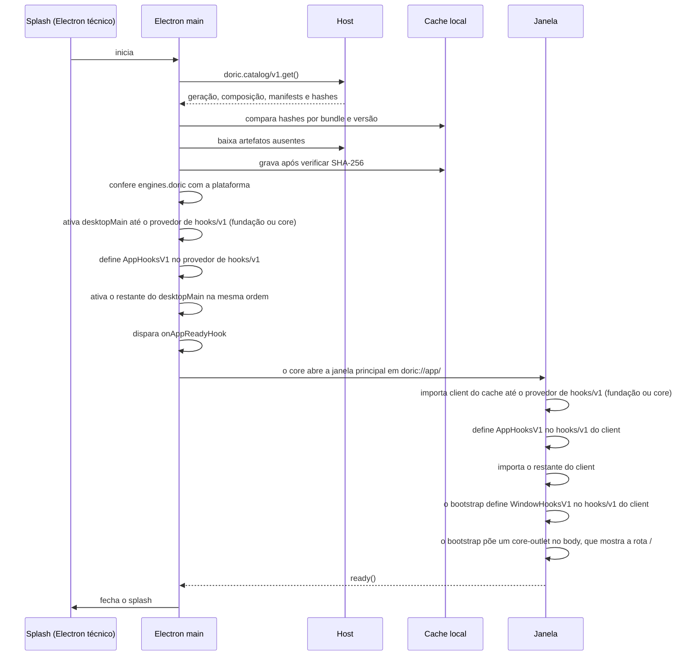

# Composição e distribuição pelo host

**Estado:** proposta. Parte da [arquitetura de bundles](../bundles.md); nada aqui descreve comportamento já implementado, e `GROUNDING.md` continua sendo o contrato da implementação atual.

## Resumo

Uma composição é a escolha de quais bundles estão habilitados, qual deles é o core e qual bundle fornece cada contrato de cardinalidade `one` que mais de um bundle habilitado oferece, e, sempre, os provedores de `storage.backend/v1` e `secrets.backend/v1`, que essa escolha coloca na fundação, em `providers`. O host guarda os bundles instalados, a composição e o catálogo resolvido de cada geração; o desktop guarda apenas um cache verificado desses artefatos. Durante o splash, o Electron main pede o catálogo ao host, baixa o que falta no cache, confere a compatibilidade com a plataforma e ativa os bundles em três etapas: primeiro a fundação (os provedores escolhidos em `providers` para contratos que o core fornece ou consome), depois o core e por último os demais, em ordem de dependência. O renderer nunca busca código por HTTP.

## O que a composição escolhe

Uma **composição** escolhe:

- quais bundles estão habilitados;
- qual é o core;
- qual bundle fornece cada contrato de cardinalidade `one` que mais de um bundle habilitado oferece, e, sempre, os provedores de `storage.backend/v1` e `secrets.backend/v1`, que essa escolha coloca na fundação, em `providers`.

Cada contrato declara sua cardinalidade nas opções de `defineService`. Um contrato `one` (o padrão) tem um provedor ativo por ambiente, escolhido pela composição. Um contrato `many` aceita vários provedores sem conflito, agregados pelo consumidor, e nunca aparece em `providers`: `openai`, `openrouter` e `codex` fornecem `models.provider/v1` ao mesmo tempo, cada um registrando seu tipo configurável, seus campos e seu catálogo de modelos, e o `models/v1` do core agrega todos.

Os antigos papéis exclusivos (armazenamento durável, segredos, runtime padrão de domínio, executor e provider de sandbox) passam a ser exatamente isso: contratos `one` com um provedor escolhido, `storage.backend/v1`, `secrets.backend/v1`, `runtime/v1`, `executor/v1` e `sandbox/v1`. `storage.backend/v1` e `secrets.backend/v1` são fornecidos pelo bundle `postgres` por padrão; o `secrets.backend/v1` padrão guarda cada segredo como envelope AES-256-GCM sob `DORIC_CREDENTIAL_KEY`, como o credential store atual do host. O `storage/v1` e o `secrets/v1` do core são fachadas sobre esses backends. O mesmo vale para os serviços básicos que o core fornece por padrão, como `hooks/v1`, `settings/v1`, `secrets/v1` ou `storage/v1`: qualquer contrato sem prefixo `doric.` pode ser fornecido por outro bundle. Contratos `doric.*` são da plataforma e não aceitam outro provedor.

```json
{
  "core": "core",
  "enabled": [
    "core",
    "runtime",
    "direct",
    "postgres",
    "myhooks",
    "layout",
    "settings",
    "chat",
    "files",
    "git"
  ],
  "providers": {
    "hooks/v1": "myhooks",
    "storage.backend/v1": "postgres",
    "secrets.backend/v1": "postgres",
    "runtime/v1": "runtime",
    "executor/v1": "direct"
  }
}
```

Neste exemplo, `myhooks` e o core fornecem `hooks/v1`, e a composição escolhe `myhooks`. Fora da fundação, um contrato com um único provedor habilitado não precisa aparecer em `providers`. Os provedores dos contratos que o core consome (`storage.backend/v1` e `secrets.backend/v1`) sempre aparecem em `providers`, mesmo quando `postgres` é o único provedor habilitado, porque é essa escolha que os coloca na fundação e os ativa antes do core.

## Fundação e ordem de ativação

Em cada ambiente, o loader ativa os bundles nesta ordem:

1. **Fundação:** os bundles escolhidos em `providers` para contratos que o core fornece ou consome. No exemplo, `myhooks` (para `hooks/v1`) e `postgres` (para `storage.backend/v1` e `secrets.backend/v1`). Um bundle da fundação só pode declarar `requires` de contratos `doric.*`, que são da plataforma e sempre existem.
2. **Core:** o core pode declarar `requires` apenas de contratos que a fundação fornece, `storage.backend/v1` e `secrets.backend/v1`.
3. **Demais bundles:** em ordem de dependência, conforme os `requires` de cada manifesto.

Quando a composição escolhe outro provedor para um contrato que o core também fornece, o loader não registra a implementação do core para esse contrato naquele ambiente. O `services.use` do próprio core devolve o provedor escolhido: com `myhooks` na fundação, o core registra seus handlers de hooks no `hooks/v1` de `myhooks`, como qualquer outro bundle.

A chave de `providers` é só o ID do contrato, mas o provedor é resolvido por ambiente, porque o ambiente de cada contrato faz parte da definição. A escolha vale em cada ambiente em que o bundle escolhido fornece o contrato; nos outros ambientes, o provedor padrão continua. Se `myhooks` só tem parte `host`, ele fornece `hooks/v1` no `host`, e o core continua fornecendo `hooks/v1` no `desktopMain` e no `client`. O mesmo vale para `settings/v1`: escolher outro provedor no `host` não troca as preferências locais do desktop que o core fornece no `desktopMain`. Nenhum ambiente fica sem um contrato que o core fornece só porque a composição escolheu outro provedor em outro ambiente.

Se dois bundles habilitados fornecem o mesmo contrato `one` no mesmo ambiente e `providers` não escolhe nenhum, o primeiro na ordem de ativação fica com o contrato e o segundo vai para quarentena com motivo. Como a fundação e o core ativam antes dos demais, sem escolha em `providers` o core sempre fica com os contratos que fornece, e o bundle que pretendia substituí-lo vai para a quarentena. Para substituir um serviço básico, a composição precisa nomear o substituto em `providers`, o que o coloca na fundação. Contratos `many` nunca geram esse conflito.

Quais janelas abrir é decisão do core, não da composição; ver [janelas abertas pelo core](./windows.md). Contribuições múltiplas, como tools, views e hooks, formam coleções ordenadas. Habilitar um bundle e selecionar uma implementação são decisões diferentes.

A escolha do core está descrita em [bundle core e quarentena](./core.md), e a troca de provedores de contratos em [contextos e capacidades](./contexts.md) e [serviços entre bundles e canais de mensagens](./services-and-channels.md).

## O host como fonte de verdade

O **host é a fonte de verdade**. Ele guarda:

- os bundles instalados, com manifesto e artefatos de todos os ambientes;
- a composição;
- o catálogo resolvido de cada geração, com quarentena e motivos.

O desktop guarda apenas um cache verificado.

## Fluxo do splash

Durante o splash:



1. O main pede ao host o catálogo da geração ativa: composição, manifests e o hash de cada arquivo.
2. Para cada parte `desktopMain` e `client`, o main procura `userData/bundles/<id>@<version>/` no cache. Arquivos ausentes ou com hash diferente são baixados do host e gravados de forma atômica; o SHA-256 do catálogo garante a integridade do cache.
3. O main confere `engines.doric` contra a plataforma instalada. Uma parte incompatível entra em quarentena no desktop, e o motivo é reportado ao diagnóstico do host. A política de compatibilidade está em [versionamento semântico](./versioning.md).
4. O main ativa as partes `desktopMain` na ordem fundação, core e demais. Depois que o provedor de `hooks/v1` do ambiente ativa (o core, por padrão, ou o escolhido em `providers`), a plataforma chama `define(AppHooksV1)`, passa a disparar `execute` e dispara o `onAppReadyHook` depois que tudo ativou. O core abre a janela principal nesse hook, com `{ key: 'workspace', path: '/' }`, e a janela carrega `doric://app/`. Cada janela importa suas partes `client` de `doric://app/bundles/<id>@<version>/…`, servidas a partir do cache verificado, na mesma ordem. No `client`, depois que o provedor de `hooks/v1` do client ativa, o bootstrap de cada janela define `AppHooksV1` e `WindowHooksV1` (`onCloseHook`, `onFlushHook`) no `hooks/v1` do client, importa o restante das partes `client`, põe um `<core-outlet>` no `body`, que mostra a rota do path da janela (veja [o outlet](./navigation.md#o-outlet-core-outlet)), e executa `WindowHooksV1` quando o main pede o fechamento da janela.
5. O splash fecha quando a primeira janela chama `ready()`. Uma falha leva a mesma superfície ao estado de recuperação descrito em [splash e recuperação](./splash-and-recovery.md).

O `onAppReadyHook` é um hook do app declarado pela plataforma em `AppHooksV1` (`doric.app.hooks/v1`, importado de `bundle/contracts`) com `defineHook`/`defineHooks`. Qualquer bundle, não só o core, registra handlers dos hooks do app. O core registra o seu pelo serviço, sem atalho no contexto:

```ts
import { AppHooksV1, HooksV1, type DesktopContext } from 'bundle/contracts';

export function activate({ services }: DesktopContext) {
  const hooks = services.use(HooksV1);
  hooks.use(AppHooksV1).onAppReadyHook(async (input, call) => {
    // abre a janela principal em "/" pelo contrato nativo doric.windows/v1
  });
}
```

A plataforma é só mais um consumidor de `hooks/v1`: se a composição escolher outro provedor, o app define e dispara os hooks do ciclo de vida por esse provedor. Pela mesma lógica, a plataforma lê settings, secrets, tools e storage pelos contratos, sem conhecer a implementação. O `onActivateHook` dos bundles ativados antes do provedor de `hooks/v1`, inclusive o dele, não é observável, porque eles ativam antes de o contrato existir; no caso padrão, em que o core fornece `hooks/v1`, isso vale para os bundles da fundação, como `postgres`. Uma falha do `activate` de um bundle leva à quarentena; uma falha de um handler de `onActivateHook` (`observe`) só vai ao diagnóstico. Ver [hooks e ciclo de vida](./hooks.md).

O catálogo (`doric.catalog/v1`), a quarentena, o diagnóstico, o splash e a recuperação continuam na plataforma porque precisam funcionar sem o core; pela mesma razão, a plataforma tem log próprio, independente do `log/v1` do core. Como o core vira dependência de quase todos os bundles, uma falha do core leva ao modo de recuperação.

## Quem baixa e de onde o renderer importa

O renderer nunca busca código por HTTP: quem baixa é o main, e o renderer só importa da origem `doric://app`. A origem e o handler do protocolo estão em [protocolo doric://](./doric-protocol.md).

## Host inacessível e operação desconectada

Se o host estiver inacessível, o splash mostra o estado da conexão e tenta de novo. A opção “abrir com a última composição conhecida” usa o snapshot do catálogo em cache, sempre em modo desconectado e marcado como cópia.

## Geração nova com o app aberto

Quando o host publica uma geração nova com o app aberto, o main baixa os artefatos em segundo plano. Cada janela mantém sua geração client até recarregar, e uma mudança em `desktopMain` sobe um `utilityProcess` da geração nova e encerra o antigo depois que as janelas que dependem dele recarregam. O processo por geração está em [isolamento por processo](./process-isolation.md).

## Operações do host expostas à parte client

A parte client alcança pela ponte os serviços do host que declara em `requires`. Serviços do host não viram rotas de rede automaticamente. A ponte e a preservação de endpoints durante a migração estão em [serviços entre bundles e canais de mensagens](./services-and-channels.md).

## Relações

- [Manifesto v1](./manifest.md): define `engines.doric`, as partes `desktopMain` e `client` e os demais campos que o catálogo publica.
- [Bundle core e quarentena](./core.md): a composição escolhe o core, a fundação ativa antes dele, e a quarentena registra as partes incompatíveis detectadas no fluxo do splash e os provedores concorrentes sem escolha em `providers`.
- [Splash e recuperação](./splash-and-recovery.md): é a superfície onde o download, a reconexão e a recuperação acontecem.
- [Versionamento semântico](./versioning.md): fornece as regras com que o main confere `engines.doric` contra a plataforma.
- [Contextos e capacidades](./contexts.md): descreve o contexto só com serviços e os contratos cujo provedor a composição escolhe em `providers`.
- [Hooks e ciclo de vida](./hooks.md): define o `onAppReadyHook` disparado pela plataforma por `hooks/v1` depois da ativação, no qual o core abre a janela principal, e o `WindowHooksV1` que o bootstrap de cada janela define no `client`.
- [Armazenamento](./storage.md): descreve `storage.backend/v1` e `secrets.backend/v1`, fornecidos por `postgres` na fundação, e as fachadas `storage/v1` e `secrets/v1` do core.
- [Janelas abertas pelo core](./windows.md): explica por que quais janelas abrir é decisão do core e não da composição.
- [Protocolo doric://](./doric-protocol.md): é a única origem de onde o renderer importa as partes `client` do cache verificado.
- [Isolamento por processo](./process-isolation.md): descreve o `utilityProcess` por geração que é trocado quando `desktopMain` muda.
- [Serviços entre bundles e canais de mensagens](./services-and-channels.md): trata da escolha de provedores de contratos, dos serviços do host alcançáveis pela ponte e da conferência de exigências host contra o catálogo publicado.
- [Observabilidade e diagnóstico](./observability.md): recebe os motivos de quarentena reportados ao diagnóstico do host.
