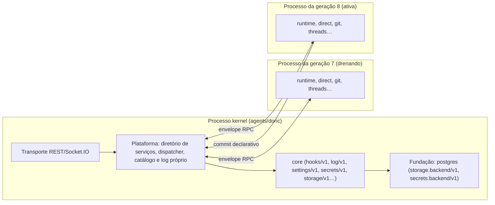

# Isolamento por processo

**Estado:** proposta. Parte da [arquitetura de bundles](../bundles.md); nada aqui descreve comportamento já implementado, e `GROUNDING.md` continua sendo o contrato da implementação atual.

## Resumo

Isolamento por processo define em quais processos o código de bundles roda. O destino aprovado é a **opção B, processo por geração**: um processo kernel guarda o transporte, o storage, o catálogo e o diretório de serviços e roda a plataforma, a **fundação** (os provedores escolhidos em `providers` para contratos que o core fornece ou consome, como `postgres` para `storage.backend/v1` e `secrets.backend/v1`) e o [core](./core.md); os bundles `feature` de cada geração rodam num processo filho próprio. Uma geração nova é um processo novo, o que permite trocar código sem reiniciar o app e limita uma falha à geração em que ela aconteceu. Kernel e geração conversam por um envelope RPC único, validado pelo JSON Schema gerado do zod do contrato, que carrega o `call.caller` preenchido pelo dispatcher do kernel.

## Decisão

Em 2026-10-08 o usuário aprovou a **opção B, processo por geração**, como destino. Isso amplia o escopo da HC-003 de `GROUNDING.md` para esta arquitetura; a aprovação vale para o desenho, e a implementação continua sujeita às etapas e validações da [migração](./migration.md). As opções A e C ficam registradas como alternativas descartadas.

## Problema

Hoje todo o código do host roda num único processo Node, e o Electron main roda num único processo. Isso limita duas coisas:

- um módulo ESM não pode ser descarregado, então trocar código exige reiniciar;
- uma falha ou travamento de um bundle derruba o processo inteiro.

## Opções avaliadas

| Opção                   | Desenho                                                                                                   | Troca de código sem reinício   | Isolamento de falha | Custo                                                     |
| ----------------------- | --------------------------------------------------------------------------------------------------------- | ------------------------------ | ------------------- | --------------------------------------------------------- |
| A. Processo único       | Kernel e todos os bundles no mesmo processo, como hoje                                                    | Não                            | Nenhum              | Nenhum custo novo                                         |
| B. Processo por geração | Kernel num processo; os bundles `feature` de uma geração num processo filho; nova geração = novo processo | Sim, drenando a geração antiga | Por geração         | Um processo Node extra por geração viva; IPC nas chamadas |
| C. Processo por bundle  | Cada parte `host` de bundle num processo próprio                                                          | Sim, por bundle                | Por bundle          | N processos; toda chamada entre bundles atravessa IPC     |

## Kernel e processo por geração



### O que fica no kernel

Na opção B, o kernel guarda o transporte, a conexão com o storage, o catálogo, o diretório de serviços e a publicação pós-commit. Ele roda a parte da plataforma que fica no host (catálogo, diagnóstico, dispatcher e o log próprio da plataforma, que não depende do core), a fundação e o [core](./core.md). Os demais bundles de uma geração rodam num processo filho. O splash e a recuperação não rodam no kernel: são uma superfície técnica do app (`app/doric`) que lê `doric.catalog/v1` e `doric.diagnostics/v1` do kernel (ver [splash e recuperação](./splash-and-recovery.md)).

No kernel, o loader segue a mesma ordem de ativação de qualquer ambiente:

1. **Fundação.** Os bundles escolhidos em `providers` para contratos que o core fornece ou consome: por padrão `postgres`, provedor de `storage.backend/v1` e `secrets.backend/v1` (ver [storage](./storage.md)), e, quando a composição escolhe, outro provedor como `myhooks` para `hooks/v1`. Bundles da fundação só declaram `requires` de contratos `doric.*`.
2. **Core.** O core declara `requires` apenas de contratos que a fundação fornece (`storage.backend/v1`, `secrets.backend/v1`). Quando a composição escolhe outro provedor para um contrato que o core também fornece, o loader não registra a implementação do core para esse contrato no host, e o `services.use` do próprio core devolve o provedor escolhido.
3. **Demais bundles**, em ordem de dependência, no processo da geração.

O `secrets.backend/v1` padrão do `postgres` guarda cada segredo como envelope AES-256-GCM sob `DORIC_CREDENTIAL_KEY`, como o credential store atual do host. O `secrets/v1` do core é a fachada sobre `secrets.backend/v1`, e o `storage/v1` do core é a fachada sobre `storage.backend/v1`. Como a fundação e o core rodam no kernel, backends e fachadas ficam no kernel.

Como o core fornece os serviços básicos do host (`hooks/v1`, `log/v1`, `settings/v1`, `secrets/v1`, `tools/v1`, `skills/v1`, `storage/v1`, `events/v1`, `models/v1`), quase toda chamada de um bundle da geração para esses contratos atravessa o envelope até o kernel. A plataforma também consome esses contratos pelo diretório, sem conhecer a implementação.

Por isso o provedor de cada contrato que o core fornece ou consome roda no kernel: o próprio core, por padrão, ou o bundle da fundação escolhido em `providers`, por exemplo `postgres` para `storage.backend/v1` e `secrets.backend/v1`, ou `myhooks` para `hooks/v1`. Depois que o provedor de `hooks/v1` ativa, a plataforma do kernel chama `define(AppHooksV1)` e passa a disparar `execute` dos hooks do ciclo de vida, como `onHostReadyHook`. Se esse provedor rodasse no processo de geração, a plataforma dependeria de um processo que é drenado e trocado a cada geração, e o kernel teria de chamar a geração para disparar hooks do ciclo de vida como `onHostReadyHook`. Como os bundles estruturais, um provedor da fundação só é trocado com reinício.

Qualquer bundle, não só o core, registra handlers dos hooks do app, inclusive os bundles da geração; nesse caso o `hooks/v1` do kernel invoca o handler pelo envelope. Uma falha do `activate` de um bundle leva à quarentena; uma falha de um handler de `onActivateHook` (`observe`) só vai ao diagnóstico.

Cada contrato declara cardinalidade nas opções de `defineService`. Um contrato `one` (o padrão) tem um provedor ativo, escolhido pela composição; sem escolha em `providers`, um segundo provedor vai para quarentena com motivo, e como a fundação e o core ativam antes, é o bundle substituto que vai para quarentena. São `one`, entre outros, `storage.backend/v1`, `secrets.backend/v1`, `runtime/v1`, `executor/v1` e `sandbox/v1`. Um contrato `many` aceita vários provedores sem conflito, agregados pelo consumidor: `openai`, `openrouter` e `codex` fornecem `models.provider/v1` no processo da geração, e o `models/v1` do core, no kernel, os agrega pelo envelope. Um provedor escolhido para `skills/v1`, `events/v1` ou `models/v1`, contratos que o core fornece, também é fundação: ativa antes do core, no kernel, e só declara `requires` de contratos `doric.*`.

### Troca de geração e recuperação

- Execuções novas vão para a geração ativa.
- As execuções que estavam em curso terminam ou pausam na geração antiga, que então é encerrada.
- Se o processo de uma geração cair, as execuções dele falham ou pausam, o kernel sobe o processo de novo e as Threads retomam pelo checkpoint, com a mesma semântica de recuperação que existe hoje.

### Criação da geração pelo kernel

O kernel cria a geração e conversa com ela por mensagens:

```ts
import { fork } from 'node:child_process';

const startGeneration = (generation: GenerationCatalog) => {
  const child = fork(generationRunnerPath, [], { serialization: 'advanced' });
  child.send({ kind: 'activate', generation });
  child.on('message', (message: RunnerMessage) =>
    dispatcher.receive(generation.id, message),
  );
  child.on('exit', (code) => recovery.generationExited(generation.id, code));
  return child;
};
```

### Processo filho

O processo filho ativa os bundles e responde às chamadas. Cada parte `host` recebe o mesmo `HostContext` de qualquer processo, `{ services }`; os serviços do kernel chegam como stubs tipados no diretório da geração:

```ts
process.on('message', async (message: KernelMessage) => {
  if (message.kind === 'activate') {
    // ctx: HostContext = { services }, com os contratos do kernel resolvidos por stubs
    await activateBundles(message.generation, { services: kernelServices });
    return;
  }
  if (message.kind === 'call') {
    const result = await services.invoke(message);
    process.send?.(result);
  }
});
```

## Envelope RPC

O envelope é o mesmo para qualquer chamada que atravessa o processo. Ele leva o `call` (tipo `Call` de `bundle/contracts`) que todo `execute` de método, comando e tool e todo handler de hook recebem. `contract` e `method` apontam para um serviço definido com `defineService` e `defineMethod` (ver [contratos](./contracts.md)), e o dispatcher valida `input` e `output` pelo JSON Schema gerado do zod desse contrato. No mesmo processo, a validação usa o próprio schema zod; o JSON Schema gerado é o formato usado quando a chamada atravessa processos.

```ts
type CallMessage = {
  kind: 'call';
  id: string;
  contract: string; // 'git.commands/v1'
  method: string; // 'switchBranch'
  input: unknown;
  deadline: number;
  caller: { bundleId: string; version: string; generation: number }; // preenchido pelo dispatcher
  scope: {
    projectId?: string;
    threadId?: string;
    promptId?: string;
    windowKey?: string; // preenchido pelo dispatcher em chamadas de janela client
  };
  trace: { traceparent: string };
};
type ResultMessage =
  | { kind: 'result'; id: string; ok: true; output: unknown }
  | {
      kind: 'result';
      id: string;
      ok: false;
      error: { code: string; message: string };
    };
type CancelMessage = { kind: 'cancel'; id: string };
```

Todo stub aceita como último argumento opcional um `call` pai (o `call` recebido) ou `{ signal, deadline }`. Com um pai, o dispatcher herda dele `scope`, `signal` e `trace`. O `caller` não é herdado: em cada salto, o dispatcher o preenche com o bundle que faz a chamada, a partir da geração e do bundle que originou a mensagem. No `execute(input, call, services)` do `switchBranch` do git, `call.caller` é quem chamou o git; quando o git chama `events/v1` repassando esse `call`, o `caller` do novo salto é `git`. Em toda chamada que sai de uma janela client, o dispatcher preenche `scope.windowKey`.

O `call.caller` serve para diagnóstico, log e para o handler saber quem disparou a chamada: é dele que o `log/v1` tira `bundleId`, `version` e `generation` de cada registro; `environment` vem do processo do provedor de `log/v1` (ver [observabilidade](./observability.md)). Do lado que recebe, `deadline` e `CancelMessage` viram o `call.signal`, e `trace` vira `call.trace`.

Um método cujo schema usa `z.custom` (funções, classes, elementos) só funciona no mesmo processo; o dispatcher recusa a chamada que atravessaria o envelope. O diretório de serviços e os stubs tipados estão em [serviços e canais](./services-and-channels.md).

## Consequências

Consequências que valem para B e C:

- Transações não podem receber um handle vivo de outro processo. O storage precisa do commit declarativo descrito em [contrato independente de backend](./storage.md): o bundle envia um lote com revisões esperadas, e o kernel executa o lote de forma atômica.
- Eventos de streaming, como deltas de tokens, atravessam o IPC; o dispatcher agrupa as entregas para não pagar um envio por token.
- Leases de sandbox e conexões Docker ficam no processo do bundle `runtime`, provedor de `runtime/v1`. O `execute` de uma tool recebe `(payload, call, services)` e usa serviços no escopo da chamada, como `services.use(RuntimeWorkspaceV1, call.scope)` e `services.use(RuntimeThreadsV1, call.scope)`, que chegam pelo stub quando o provedor está em outro processo.
- No desktop, as partes `desktopMain` rodariam em `utilityProcess` por geração, com `DesktopContext`. APIs que só existem no main (`BrowserWindow`, `Menu`, `Notification`) são pedidas ao broker do main por `MessagePort`; o diretório de cache por bundle vem de `doric.cache/v1`, contrato da plataforma no `desktopMain`. Na parte `client`, com `ClientContext`, cada janela já é um processo de renderer.
- Qualquer serviço fornecido no `desktopMain` ou no `host` é alcançável por partes `client` pela ponte quando a parte `client` o declara em `requires`, como `windows/v1` e `menus/v1` do core.

A opção B resolve a troca de código e isola falhas por geração, com custo de um processo extra por geração viva.

## Relações

- [Contratos e a família define\*](./contracts.md): o envelope é validado pelo JSON Schema gerado do zod dos contratos definidos com `defineService` e `defineMethod`, cujas opções declaram só a cardinalidade.
- [Serviços entre bundles e canais de mensagens](./services-and-channels.md): o diretório de serviços, os stubs tipados e a propagação de `call` são o que o dispatcher do kernel roteia entre processos.
- [Armazenamento genérico e histórico](./storage.md): o commit declarativo com revisões esperadas é exigido porque transações não atravessam processos; `postgres` fornece `storage.backend/v1` e `secrets.backend/v1` no kernel.
- [Composição e distribuição pelo host](./composition-and-distribution.md): a composição define o catálogo de cada geração que o kernel ativa num processo novo e escolhe em `providers` a fundação que roda no kernel.
- [Bundle core e quarentena](./core.md): o core roda no kernel, depois da fundação e junto da plataforma; falha do core leva ao modo de recuperação.
- [Hooks](./hooks.md): a plataforma do kernel define `AppHooksV1` no provedor de `hooks/v1` e dispara os hooks do ciclo de vida, cujos handlers podem estar na geração.
- [Contextos e capacidades](./contexts.md): o contexto entregue aos bundles (`HostContext`, `DesktopContext`, `ClientContext`) tem só `services`; o processo é o que isola falhas.
- [Observabilidade e diagnóstico](./observability.md): o campo `trace.traceparent` do envelope propaga o rastreio entre kernel e geração, e `call.caller` identifica o bundle de cada registro.
- [Migração em entregas verificáveis](./migration.md): a implementação da opção B segue as etapas e evidências da migração.
